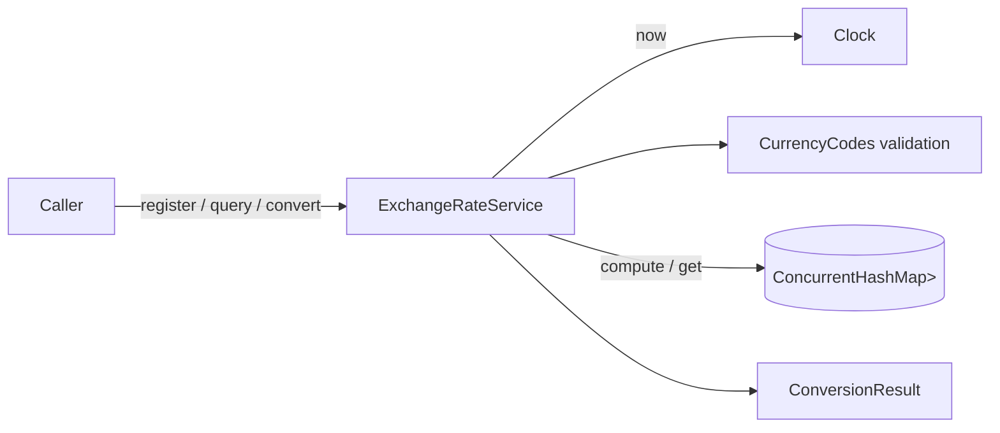

# Design Document

## Overview

The Currency Exchange Rate Service is a small, dependency-free Java 25 library. It stores time-versioned exchange rates per ordered currency pair, answers current and historical queries, and converts amounts. It follows the project steering files (`tech.md`, `structure.md`): Maven only, JUnit 5, `java.util.concurrent` state, records for data, `BigDecimal` for money, and an injected `Clock`.

Key design decisions:

- **Copy-on-write snapshots per pair.** Each Currency_Pair maps to an immutable, ascending-sorted `List<ExchangeRate>`. A write builds a new list and swaps it in atomically with `ConcurrentHashMap.compute`. Readers take one reference and work on a list that never changes. This gives Requirement 5.3 (all-or-nothing visibility) and 3.10 (previously returned lists never change) without locks. Histories are small and read-heavy, so the O(n) copy per write is an acceptable trade for simplicity. (`ConcurrentSkipListMap` was considered. It is weakly consistent during iteration, which makes the 5.3 guarantee harder to state.)
- **No blocking, so interrupts are trivially safe.** No operation waits on a lock, so none can be interrupted mid-way. Requirement 5.6 holds because the service never clears or consumes the interrupt flag.
- **Validation before mutation.** Every input is validated before the map is touched, so rejected calls leave state unchanged.
- **Clock read once per operation.** Operations that need "now" call `clock.instant()` exactly once.
- **Plain Java, no PBT from scratch.** Property tests use jqwik (JUnit 5 platform engine).

Research notes: `ConcurrentHashMap.compute` runs the remapping function atomically per key, which is what the replace-or-insert write needs. The JDK documentation recommends keeping the function short and free of other map updates, which this design respects. `BigDecimal.setScale(n, RoundingMode.HALF_EVEN)` and `divide(x, scale, mode)` give the exact rounding the requirements specify.

## Architecture



Register flow:

```mermaid
sequenceDiagram
    participant C as Caller
    participant S as ExchangeRateService
    participant M as ConcurrentHashMap
    C->>S: register(base, target, rate, at)
    S->>S: validate codes, instant, rate; round rate
    S->>M: compute(pair, fn)
    M-->>S: new immutable sorted list stored
    S-->>C: ExchangeRate
```

Package layout (base package `com.example.exchangerate`):

```
pom.xml
src/main/java/com/example/exchangerate/
    ExchangeRateService.java
    ExchangeRate.java
    ConversionResult.java
    CurrencyPair.java
    RateNotFoundException.java
    CurrencyCodes.java          (package-private validation helper)
src/test/java/com/example/exchangerate/
    ExchangeRateServiceRegisterTest.java
    ExchangeRateServiceQueryTest.java
    ExchangeRateServiceConvertTest.java
    ExchangeRateServiceConcurrencyTest.java
    ExchangeRateServicePropertiesTest.java
    ConventionsTest.java
    support/MutableClock.java
```

## Components and Interfaces

### ExchangeRateService (public final class, thread-safe)

```java
public final class ExchangeRateService {
    public static final int RATE_SCALE = 10;
    public static final int AMOUNT_SCALE = 2;

    public ExchangeRateService(Clock clock);               // NPE "clock" if null

    // Registration
    public ExchangeRate register(String base, String target, BigDecimal rate);               // effective = clock.instant()
    public ExchangeRate register(String base, String target, BigDecimal rate, Instant at);   // IAE if at == null

    // Current and historical rate
    public Optional<ExchangeRate> currentRate(String base, String target);
    public Optional<ExchangeRate> rateAsOf(CurrencyPair pair, Instant asOf);
    public List<ExchangeRate> history(CurrencyPair pair);
    public List<ExchangeRate> history(CurrencyPair pair, Instant startInclusive, Instant endExclusive);

    // Conversion
    public ConversionResult convert(BigDecimal amount, String from, String to);
    public ConversionResult convert(BigDecimal amount, String from, String to, Instant asOf);
}
```

Behavior summary:

- **register**: validate codes (null or not `[A-Z]{3}` gives IAE containing the code or "null"), then base != target, then `at != null` (when provided explicitly), then rate non-null and positive, then round to scale 10 with HALF_EVEN, then reject if the rounded value is zero ("rate rounds to zero at the Rate_Scale"). Then `compute(pair)` builds a new sorted list with any entry at the same instant replaced. `at` defaults to a single `clock.instant()` read.
- **currentRate**: validates codes and pair, then `rateAsOf(pair, clock.instant())` logic.
- **rateAsOf**: `Objects.requireNonNull` on pair and instant. Binary search on the snapshot for the greatest effective instant `<= asOf`.
- **history(pair)**: returns the snapshot (already unmodifiable, ascending). **history(pair, start, end)**: NPE on nulls, IAE if `start > end`, empty list if equal, else filtered `List.copyOf` of the half-open range `[start, end)`. Missing history returns `List.of()`.
- **convert**: validates codes, then amount (null or negative gives IAE "amount must be non-null and non-negative"). Order of checks: codes, then amount. Resolution order:
  1. from == to: rate 1, `amount.setScale(2, HALF_EVEN)`, no stored rate.
  2. direct rate as of the instant (`asOf` or `clock.instant()`, read once): `amount.multiply(rate).setScale(2, HALF_EVEN)`.
  3. inverse rate: `reciprocal = ONE.divide(inverse.rate(), 10, HALF_EVEN)`, then multiply and round to scale 2.
  4. otherwise `RateNotFoundException` naming both codes.
  The direct rate is preferred whenever one applies at that instant (Requirement 4.5).

Interface notes: `currentRate` takes codes as strings because the spec requires code-level validation messages. Methods taking `CurrencyPair` rely on the pair's own validation (see below), so the pair cannot hold invalid codes. A null pair gives NPE.

### CurrencyPair (public record, immutable, thread-safe)

```java
public record CurrencyPair(String base, String target) {
    public CurrencyPair {  // validates via CurrencyCodes; IAE for invalid codes or base.equals(target)
    }
    public CurrencyPair inverse();
}
```

### ExchangeRate (public record, immutable, thread-safe)

```java
public record ExchangeRate(CurrencyPair pair, BigDecimal rate, Instant effectiveAt) {
    // compact constructor: requireNonNull on all; rate > 0; rate.scale() <= 10
}
```

### ConversionResult (public record, immutable, thread-safe)

```java
public record ConversionResult(BigDecimal sourceAmount, BigDecimal convertedAmount,
                               String from, String to, BigDecimal appliedRate, ExchangeRate sourceRate) {
    public Optional<ExchangeRate> exchangeRateUsed();   // empty for same-currency identity
}
```

`appliedRate` is the multiplier actually used (stored rate, reciprocal, or 1). `sourceRate` is the stored Exchange_Rate behind it, or null for the identity case, and is exposed through the Optional accessor. `from` and `to` are strings rather than a `CurrencyPair` because the identity case has equal codes, which `CurrencyPair` rejects.

### RateNotFoundException

`public class RateNotFoundException extends RuntimeException` with a message containing both codes. Javadoc declares it immutable and thread-safe.

### CurrencyCodes (package-private)

`static String requireValid(String code)` enforces non-null and `[A-Z]{3}` using a plain character check (no regex backtracking concerns, and no locale issues). It throws IAE with the code or "null" in the message.

## Data Models

| Type | Fields | Invariants |
|---|---|---|
| CurrencyPair | base, target | Both valid codes; base != target |
| ExchangeRate | pair, rate, effectiveAt | rate > 0, scale <= 10, all non-null |
| ConversionResult | sourceAmount, convertedAmount, from, to, appliedRate, sourceRate | convertedAmount scale 2 |
| Service state | `ConcurrentHashMap<CurrencyPair, List<ExchangeRate>>` | Each list immutable, ascending by effectiveAt, one entry per instant |

All amounts and rates are `BigDecimal`. No `double` or `float` appears in any public signature.

Thread-safety model: the map value is replaced, never mutated. `compute` serializes writers per key, so concurrent registrations for the same pair and instant leave exactly one entry (last writer wins), and registrations on distinct combinations are never lost.

## Correctness Properties

*A property is a characteristic or behavior that should hold true across all valid executions of a system-essentially, a formal statement about what the system should do. Properties serve as the bridge between human-readable specifications and machine-verifiable correctness guarantees.*

Reflection: 1.1 and 1.4 merge into one registration property. 1.2 stays separate (clock use). 1.5, 1.6, 1.7, 1.8, 2.5, 2.6, 4.8, 4.9 merge into one invalid-input property per input kind, with a shared "state unchanged" check. 2.1, 2.3, 2.4, 3.1, 3.2 collapse into one model-based as-of property. 3.4 and 3.5 stay separate (full vs. range). 4.2 is covered by combining Properties 4 and 8. Concurrency criteria (5.1 to 5.4) are integration-style tests and are not listed as properties.

### Property 1: Registration stores the rounded rate

For any valid Currency_Pair, positive rate that does not round to zero, and effective Instant, registering the rate results in the pair's history containing an Exchange_Rate with that instant whose rate equals the input rounded to scale 10 with HALF_EVEN (scale at most 10), and the inverse pair's history is unchanged.

**Validates: Requirements 1.1, 1.4, 1.9**

### Property 2: Default effective instant comes from the Clock

For any fixed Clock instant and valid registration without an explicit instant, the stored Exchange_Rate's effective Instant equals the Clock's instant.

**Validates: Requirements 1.2**

### Property 3: Same pair and instant replaces

For any valid pair, instant, and two rates, registering the first then the second at the same instant yields a history with exactly one entry at that instant, equal to the second rate (rounded).

**Validates: Requirements 1.3**

### Property 4: Invalid input is rejected without side effects

For any invalid input (a Currency_Code that is null or not three uppercase A to Z letters; equal base and target codes; a null, zero, or negative rate; a positive rate that rounds to zero at scale 10; a negative or null amount), the corresponding operation throws IllegalArgumentException with a message containing the offending value where applicable, and every pair's history is unchanged afterwards.

**Validates: Requirements 1.5, 1.6, 1.7, 1.8, 2.5, 2.6, 4.8, 4.9**

### Property 5: As-of lookup matches a reference model

For any set of registrations for a pair and any as-of Instant, `rateAsOf` returns the entry with the greatest effective Instant at or before the as-of Instant, or empty if none exists. For any Clock instant, `currentRate` is the same lookup at the Clock's instant (empty when the pair has no history or all entries are in the future).

**Validates: Requirements 2.1, 2.2, 2.3, 2.4, 3.1, 3.2, 3.3**

### Property 6: History is ordered, unique, and unmodifiable

For any sequence of registrations for a pair in any order, `history(pair)` is sorted by strictly ascending effective Instant, contains one entry per distinct instant, and rejects modification attempts with UnsupportedOperationException.

**Validates: Requirements 3.4, 3.6**

### Property 7: Range history is the half-open filter

For any history and any start and end Instants with start <= end, `history(pair, start, end)` equals the full history filtered to `start <= effectiveAt < end`, in ascending order, and is empty when start equals end. For start after end, an IllegalArgumentException is thrown.

**Validates: Requirements 3.5, 3.7, 3.8**

### Property 8: Returned histories are snapshots

For any returned history list and any later registrations, the earlier list's size and contents remain unchanged.

**Validates: Requirements 3.10**

### Property 9: Direct conversion arithmetic

For any non-negative amount and any pair with a rate in effect, the converted amount equals `amount * rate` rounded to scale 2 with HALF_EVEN, the applied rate is the stored rate, and the result has scale 2 (including amount zero). With an as-of Instant, the rate used is the one found by Property 5 at that Instant.

**Validates: Requirements 4.1, 4.2, 4.6**

### Property 10: Same-currency conversion is the identity

For any non-negative amount and valid code, converting from the code to itself returns the amount rounded to scale 2 with HALF_EVEN and an applied rate of 1, even when no rates are registered.

**Validates: Requirements 4.3**

### Property 11: Inverse conversion uses the reciprocal

For any non-negative amount and any pair with only an inverse rate in effect, the converted amount equals `amount * (1 / inverseRate)`, where the reciprocal is computed at scale 10 with HALF_EVEN, rounded to scale 2 with HALF_EVEN. When both direct and inverse rates exist, the result equals the direct-rate conversion.

**Validates: Requirements 4.4, 4.5**

### Property 12: Missing rate raises RateNotFoundException

For any pair with neither a direct nor inverse rate in effect, converting throws RateNotFoundException whose message contains both codes, and stored data is unchanged.

**Validates: Requirements 4.7**

### Property 13: Deterministic results under a fixed Clock

For any service state, fixed Clock, and operation inputs, repeating a query or conversion yields equal results.

**Validates: Requirements 6.6**

## Error Handling

| Condition | Exception | Message content |
|---|---|---|
| Null clock in constructor | NullPointerException | "clock" |
| Null or malformed Currency_Code | IllegalArgumentException | the code, or "null" |
| base equals target (register, query) | IllegalArgumentException | the code |
| Explicit null effective Instant on register | IllegalArgumentException | "effective Instant must not be null" |
| Null, zero, or negative rate | IllegalArgumentException | "rate must be positive" |
| Rate rounds to zero at scale 10 | IllegalArgumentException | "rate rounds to zero at the Rate_Scale" |
| Null pair or Instant in historical query | NullPointerException | parameter name |
| start after end | IllegalArgumentException | both instants |
| Null or negative amount | IllegalArgumentException | "amount must be non-null and non-negative" |
| No direct or inverse rate | RateNotFoundException | both codes |

All validation happens before any state change, so rejected calls never modify the map. No exception is swallowed. The service never catches `InterruptedException` because it never blocks; the thread's interrupted status is untouched (Requirement 5.6). Note for Requirement 1.5 versus 3.9: methods taking a `CurrencyPair` get validation from the pair constructor (IAE), while a null pair is an NPE.

## Testing Strategy

Property-based testing applies here: the core is pure, in-memory logic (rounding, ordering, lookup, arithmetic) with a large input space. Concurrency, convention checks, and a few single-scenario criteria use example-based and integration-style tests.

**Libraries and build**: JUnit 5 via `junit-bom`, plus jqwik (JUnit 5 platform engine) for properties, all with exact pinned versions in `<properties>`. `maven-compiler-plugin` uses `<release>25</release>`. `maven-surefire-plugin` runs tests with `mvn test`. No AssertJ; use `org.junit.jupiter.api.Assertions`.

**Property tests** (`ExchangeRateServicePropertiesTest`):
- One jqwik `@Property(tries = 100)` or higher per Correctness Property 1 to 13.
- Each is tagged with a comment: `Feature: currency-exchange-rate-service, Property N: <text>`.
- Generators: valid codes (three uppercase letters), invalid codes (null, empty, blank, wrong length, lowercase, digits), rates as `BigDecimal` with up to 15 fractional digits (including near the 5e-11 rounding boundary), instants in a bounded range, and amounts with 0 to 6 fractional digits including zero.
- Reference models are simple (filter and max over a list) so they do not duplicate the implementation's binary search.
- A `MutableClock` test helper (or `Clock.fixed`) supplies time. No test reads the wall clock.

**Unit tests** (JUnit 5, `@Nested` grouping, `@ParameterizedTest`):
- At least one test per acceptance criterion of Requirements 1 to 4, nominal and error paths.
- Parameterized: at least 6 invalid codes (null, empty, blank, wrong length, lowercase, non-alphabetic); at least 3 non-positive rates (zero, negative, smallest negative); at least 3 rounding values (just below, at, and just above the midpoint 5e-11 / HALF_EVEN cases).
- Examples: null effective Instant, empty history, null-argument NPEs, null clock, interrupted-thread status preserved, record immutability and unmodifiable lists (Requirement 5.5).

**Concurrency tests** (`ExchangeRateServiceConcurrencyTest`), each with `@Timeout` of at most 30 seconds, `ExecutorService` in try-with-resources, and `CountDownLatch` or `CyclicBarrier`, never `Thread.sleep`:
- 32 or more threads released together each register a distinct rate; afterwards all are present, none duplicated or altered (5.2, 7.6).
- Many threads register the same pair and instant; exactly one entry remains and its value is one of those registered (5.4).
- Readers query and convert while writers register; every observed value is derived from a registered rate and none is null or partial (5.1, 5.3, 7.7).

**Convention tests** (`ConventionsTest`, smoke): reflection over public API for no `double`/`float`; source scan for no `HashMap`/`ArrayList` shared state and no `Instant.now()`, `System.currentTimeMillis`, or Clock-less `LocalDateTime.now()`; Javadoc thread-safety statement present on each public type (6.1, 6.3, 6.4, 6.5).

**Acceptance**: `mvn test` completes with 0 failures, 0 errors, 0 skipped (7.8, 7.9).
